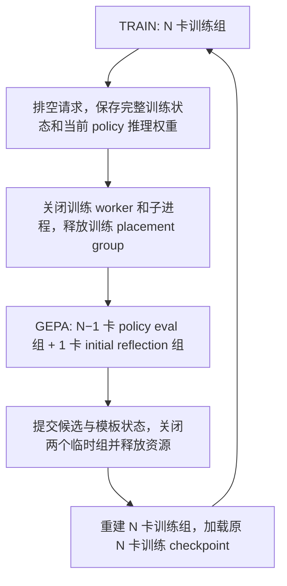

# P2O：GPU生命周期、恢复与记录规范

返回[主计划入口](../p2o_agent_implementation_plan.md)。正文保留原章节编号；跨文件的 `§` 引用按主入口的[章节导航](../p2o_agent_implementation_plan.md#章节导航)定位。设计与待做项不代表已实现，当前实现范围见[TODO-00说明](modules/TODO-00.md)。

## 7. 单卡反思与 GPU 归还的具体实现

### 7.1 为什么不能直接改一个卡数配置

本地证据：

- `main_ppo.py` / `ray_trainer.init_workers` 创建固定 global resource pool 和 colocated worker；默认 actor、rollout 共用进程。
- `fsdp_workers.ActorRolloutRefWorker.__init__` 根据 `WORLD_SIZE` 创建进程组、FSDP device mesh；actor minibatch 也在初始化时按 world size 归一化。
- `_build_rollout` 要求 `world_size % tensor_model_parallel_size == 0`；sharding manager 将训练模型与 rollout 引擎关联。
- `FSDPCheckpointManager.load_checkpoint` 按 `model_world_size_N_rank_R.pt`、optimizer 和 extra state 文件恢复。本地没有直接把 N 卡分片读成 N−1 卡训练状态的逻辑。
- `RayResourcePool` 缓存 placement groups；GPU 显存 offload / vLLM sleep 不等于释放 Ray 的 GPU 预留。单独释放一个 FSDP rank 会破坏后续 collective。

Ray 的 placement group 删除是异步操作，且会杀掉仍在使用该组的任务/actor，因此要先排空并保存，再删除并等待释放完成。[Ray 官方说明](https://docs.ray.io/en/latest/ray-core/scheduling/placement-group.html#remove-placement-groups-free-reserved-resources)

### 7.2 推荐资源状态机

具体顺序：

1. 等待训练 rollout、环境 step、reward future、log-prob、update 全部完成，禁止未完成的 episode 跨资源阶段。冻结本次 GEPA 的 `policy_version`。
2. 保存 N 卡 model/optimizer/scheduler/RNG、driver RNG、dataloader/sampler cursor、P2O 状态；同时生成完整 HF 推理快照。现有脚本已请求 `hf_model`，但生命周期层仍需校验实际权重导出完成。
3. 状态文件标为 `TRAIN_SAVED` 后关闭训练 worker、rollout 引擎及其子进程；销毁整个 GPU placement group，等待所有资源释放。保留 CPU driver 与环境管理对象。
4. 建两个互不共享 GPU 的 resource pools。8 卡配置下，policy-eval 为 DP=7、TP=1；reflection 为 DP=1、TP=1。**不是 TP=7，也不是在 7 卡上做 GRPO update。**
5. policy-eval 从刚导出的当前快照加载；reflection 从不可变的 `initial_model_path` 加载。两组只提供生成，不创建 optimizer，不互相同步权重。
6. 执行完整 GEPA，policy 和 reflection 各自保持固定版本。提交搜索状态，进入 `GEPA_COMMITTED`。
7. 在 finally/恢复路径中关闭两个临时组，释放全部 GPU。创建新的 N 卡训练组，从第 2 步的 N 卡分片恢复 optimizer 等状态；下次 rollout 同步恢复后的 policy 权重。
8. 验证训练组 world size、参数版本、optimizer step、LR、RNG/sampler 状态，接入新模板后继续。GEPA 不增加 `global_steps`，不推进 scheduler。

从创建到销毁都由 verl/Ray 管理，不创建 HTTP/OpenAI 服务，不在 driver 中覆盖 `CUDA_VISIBLE_DEVICES` 绕过调度。生成后端可以复用仓库已有的 verl vLLM rollout；这里替换的是额外服务与资源管理方式，并不要求重写底层推理引擎。

### 7.3 推理 worker 需要专门处理

现有 `role="rollout"` 仍会在 `init_model` 中构造 `actor_module_fsdp`，然后再构造 rollout 引擎。单卡 reference 直接照搬可能保留额外权重副本，不应默认它是轻量推理 worker。

建议新增专用 `P2OInferenceWorker`，沿用 RayWorkerGroup/`DataProto` 调度和 verl rollout 后端，直接从完整权重加载引擎，禁用 `dummy_dtensor` 等等待训练权重同步的加载模式，不创建 FSDP 训练模型或 optimizer。提供 `init_model / generate_sequences / get_model_identity / drain / close`；显式初始化各组的并行上下文并隔离 rendezvous、端口、名称和 generation 编号。

初始模型路径/revision 在程序开始就锁定；resume 时仍恢复这一身份，不能从当前 policy checkpoint 覆盖。model identity 至少包含权重 manifest 校验信息、tokenizer 和模型配置。新 worker 配置必须 deepcopy：现有 actor 构造会原地归一化 minibatch，重建时不能把已经归一化的配置再除一遍。

单卡是否放得下当前 Qwen3-8B，要按实际 GPU 显存、dtype、上下文长度、并发和 KV cache 验证。8B BF16 权重本身约 16 GB，尚未计 KV/运行时。反思组使用独立的最大长度和并发设置，不继承训练脚本的大 token batch 预算。若单卡不够，先减并发/长度；不能无声改成当前 policy 反思或偷偷占第二张卡。

TP=1 使当前 8→7 推理布局在拓扑上成立。若以后改 TP>1，则需校验 N−1 的整除与模型要求，明确拒绝不支持布局，不把硬件 GPU 数当作所有阶段的 DP divisor。

### 7.4 性能替代方案与范围

| 方案 | 是否满足训练期恢复全部 N 卡 | 工程判断 |
| --- | --- | --- |
| 阶段边界 checkpoint + 推理组重建 | 是 | 本计划主方案；实现边界清楚，成本为权重 I/O 和引擎冷启动 |
| 训练常驻 N−1 卡，反思临时用第 N 卡 | 否 | 可供调试，但不是用户要求的最终资源方案 |
| 保留 N 个训练 rank，全部 offload，再额外共享进程/GPU | 需复杂显存和调度管理 | 不等价于释放卡，首版不采用 |
| 动态重建 N−1 卡训练组并继续更新 | 可以另做 | 需 optimizer 重分片、batch/DP 适配和更多恢复验证；GEPA 本身不需要 |

PyTorch 提供 full optimizer state 的重新分片 API，但这不代表当前仓库已支持运行中弹性 world size。[PyTorch FSDP 文档](https://docs.pytorch.org/docs/stable/fsdp.html#torch.distributed.fsdp.FullyShardedDataParallel.scatter_full_optim_state_dict)

先测切换耗时再考虑 CPU 内存快照等优化；不能跳过状态正确性直接承诺低开销。若 GPU 资源被其他任务抢占，阶段恢复使用有界等待并保持可恢复 checkpoint，不循环创建悬挂 placement group。

## 8. 断点续训、阶段提交与记录

### 8.1 Math 实现的借鉴与差异

必须阅读原 `_save_checkpoint`、`_load_checkpoint`、`_finalize_epoch_prompt_optimization`、`_resume_pending_gepa_if_needed`。Math 保存 `gepa_state.pt` 中的模板/候选/dev分数/按样本分配/困难样本/signatures，并用 `before_gepa_optimization`、`after_gepa_optimization` 区分恢复阶段。它对before阶段恢复通常重新执行GEPA；不是完整的候选中间进度恢复，也不应照搬其global_step加减来代表搜索。

Agent版本需要额外保存跨epoch hard bank、轻量TaskRecipe、当前随机实例面板、评估/反思请求账本、模板规则版本、资源阶段和新prompt长度配置。每个组件的state_dict/load_state_dict合同应从TODO-00定义；最后才补状态会导致无法复现的隐式依赖。

### 8.2 状态清单与原子性

- 训练：model/optimizer/scheduler、已完成global_step、原生epoch与batch cursor、dataloader、driver/Ray worker RNG、可恢复的环境任务sampler/游戏迭代器状态。数据行占位的dataloader state不能代替环境采样状态；无法导出某环境内部状态时先停问用户，不能声称已实现精确训练流续接。
- P2O：interval_hard及区间边界、ever_hard完整索引、sample_key规范/配方、success向量及来源phase、cycle_template_registry、latest_solved_cycle、模板正文/拒绝原因/求解证据/采样权重及RNG，last_gepa_completed_epoch及已完成epoch计数。
- GEPA：cycle id、冻结policy快照、train/dev sample_key split、抽好的instance seed/必要面板物化材料、面板ID、跨周期dev固定实例注册表及其物化材料、候选/selection状态、已完成evaluation结果、pending request id、预算used/reserved、搜索/反思RNG。
- 配置与身份：固定πinit路径/权重与tokenizer fingerprint、policy_version、schema/rule/source/data版本、base=4096/template=2048/effective=6144、完整resolved config。

阶段建议为 `TRAIN → TRAIN_SAVED → GEPA_RUNNING → GEPA_COMMITTED → TRAIN_RESTORED`。manifest最后原子提交，先验证全部shards/模型导出/P2O artifact存在，再推进latest指针。训练checkpoint使用中的恢复点pin住，兼容现有keep_latest_full_checkpoint清理，不能删掉唯一可回退的N卡训练状态。

cache key包括policy_version、recipe/instance/panel、template hash、decoding config和replicate seed；world或policy变更即失效。保存任务配方的随机化不意味着恢复时可以重抽已经提交的GEPA面板。非确定性LLM反思的输出一旦生成并提交就保存，恢复时优先复用；不要求重新采样时输出逐字相同。

### 8.3 中断恢复合同

| 中断位置 | 恢复行为 | 必测结果 |
| --- | --- | --- |
| 正常训练checkpoint后 | 从下一完整update/epoch位置恢复 | 不重复update，LR/optimizer step连续 |
| TRAIN_SAVED后、临时组创建前 | 按保存阶段建立7+1组，加载固定快照 | πinit不被当前policy覆盖 |
| GEPA中、某candidate评估完成后 | 复用已提交结果，只补未完成request | 不重复计作成功样本，已耗预算不归零 |
| GEPA_COMMITTED后、训练组恢复前 | 不重跑GEPA，恢复N卡训练状态并装载新模板 | 模板不丢失，不多增训练步 |
| 临时组创建/销毁失败 | 根据阶段和actor身份清理本run残留，保留恢复点，报告用户 | 不杀其他run，不无限创建PG/actor |

对pending调用使用write-ahead预算预留：进程崩溃后无法确定是否已完成的调用，不能悄悄宣称“恰好一次计费”。保留uncertain/orphan成本记录，有限重试按新attempt记账；只有一个结果提交到对应EvalRequest。第一版只在完整episode/update边界恢复，半条episode丢弃并显式重试。策略2还须记录base完成/是否需要rescue/rescue完成/是否已update；恢复时重建同初始实例，不重复update、不把base和rescue计成两个独立样本。若不支持中间阶段保存，则从整个未提交batch重放并记录额外成本，不能接着不完整memory继续。

### 8.4 每做一件事就更新记录

主计划入口为 [p2o_agent_implementation_plan.md](../p2o_agent_implementation_plan.md)，本页维护资源/恢复设计与记录规范；实施记录为 [docs/p2o/implementation_log.md](implementation_log.md)，预检记录为 [docs/p2o/test_records/TODO-00-preflight.md](test_records/TODO-00-preflight.md)，当前验收为 [TODO-00.md](test_records/TODO-00.md)。后续验收记录放在 `docs/p2o/test_records/<TODO编号>.md` 并从本文链接；预检不代表TODO实现或验收完成。

每次发现计划与现实diff时先登记 `问题ID→预期→实际证据→影响的模块/TODO→可选改法→用户决定→验收变更`，暂停依赖实现；未经用户决定的提案保持待定，不能先实现后补文档。即使只是后面TODO的前提被推翻，也要当场说明。用户确认后在变更记录保留原因，正文替换为新方案。

每次修改/测试后记录：TODO id、时间、涉及文件与版本、具体改动/原因、resolved配置和模型身份、测试命令/资源、预期与实际输出、关键数据摘要、结论/失败原因、日志artifact路径。大trace或张量放运行artifact，不全文塞进.md；但markdown必须足以判断是否通过。命令/配置记录不包含认证密钥。

每个大TODO结束，更新状态、证据链接、剩余问题、下一TODO受影响部分；如果接口/随机化/CRM优化改变了后续假设，先改本文对应段落与验收，再往下做。保留简短决策变更记录，正文只保留当前设计，不叠加互相冲突的“新版说明”。

### 停点报告的固定内容（2026-10-15 用户补充）

每次完成大 TODO 或因问题暂停，必须同时更新 Markdown 和在对话中说明；对话应能独立读懂，不以“详见文档”代替汇报。至少覆盖：

- 当前进度、实现提交/涉及文件、完成内容与原因；明确可执行实现、接口声明和后续计划的区别。
- 核心代码路径、关键类/函数和数据流，配一两个有助理解的输入输出例子。
- 测试环境/命令、预期与实际结果、证据/artifact 路径；注明模拟/真实环境、CPU/GPU及未验证内容。
- 当前问题、影响、选项与需用户决定的事项；已解决问题和后续待决问题分别写清。
- 本次更新的文档位置、下一项边界，并暂停等待反馈。

主入口维护简短状态和导航；模块解释放 `docs/p2o/modules/<TODO编号>.md`，详细验收证据放 `docs/p2o/test_records/<TODO编号>.md`，环境共性放环境文档，经过与决策按次记入实施日志。已有内容优先链接，不把所有细节追加回主计划。
